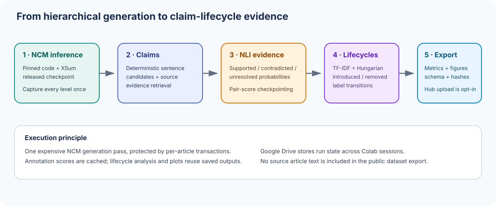
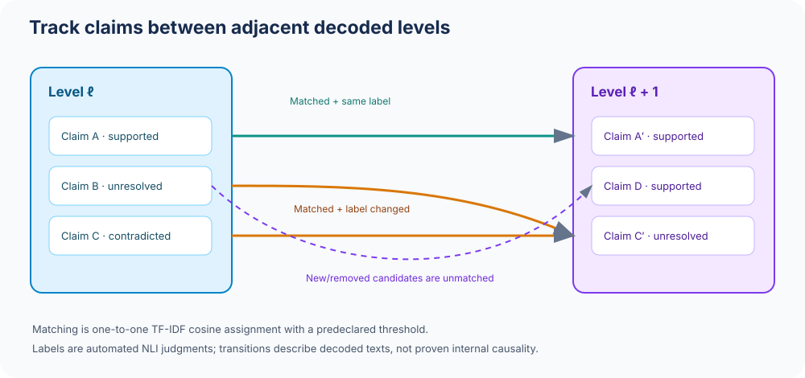
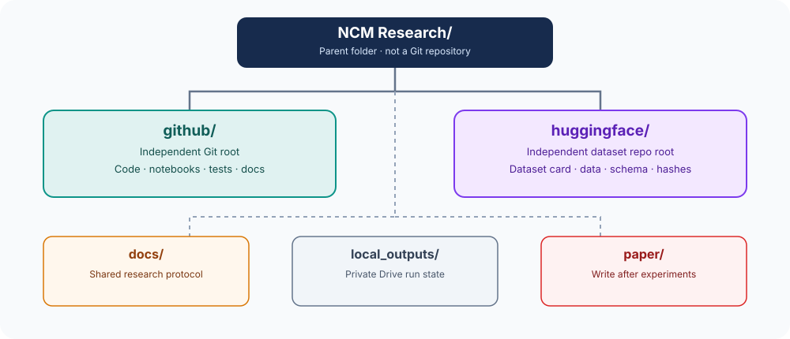

<div align="center">
  

  # NCM Hierarchy Factuality

  **Fact lifecycles across Next-Concept Modeling's decoded summarization hierarchy**

  [Official NCM paper](https://arxiv.org/abs/2610.14162) · [Official NCM implementation](https://github.com/HazyResearch/ncm) · the separate local Hugging Face dataset package under `NCM Research/huggingface/`
</div>

This repository investigates when sentence-level candidate claims are observable, retained, removed or assigned different source-evidence labels across cumulative intermediate decodings of the released NCM XSum summarization checkpoint.

> **No results are pre-populated.** This repository provides the reproducible pipeline. Findings must be generated by running the experiment and validated against its manifest.

## Research question

Do claim-level factuality judgments change systematically across NCM's coarse-to-fine decoded hierarchy, and how closely do those judgments track reference-overlap measures such as ROUGE-L?

## At a glance

| Component | Role |
|---|---|
| Official NCM checkpoint and source code | Pinned inference implementation and model configuration |
| Full NCM XSum test set | The default full published test split, not a pilot subset |
| Source-evidence retrieval + NLI | Automated support signal for sentence-level candidates |
| Cross-level matching | TF-IDF cosine similarity and one-to-one Hungarian assignment |
| Article-level statistics | ROUGE by level, claim rates, transition counts, cluster bootstrap intervals |
| Reproducible export | Parquet/CSV/JSONL, manifest, SHA-256 checksums and optional Hub upload |

## Visual research model



The key unit is a **decoded hierarchy level**, not an assumed shorter summary. NCM represents text using a hierarchy of discrete codes and generates those levels coarse to fine. The official code exposes cumulative reconstructions, and this project decodes each cumulative level for analysis.

## Repository map

```text
github/
├── README.md / LICENSE / CITATION.cff / .gitignore
├── src/ncm_factuality/     # reusable inference, scoring, analysis and export code
├── notebooks/              # ordered Colab interface (00–05)
├── configs/                # pinned research parameters and thresholds
├── tests/                  # CPU-only synthetic tests
├── scripts/                # validation and publishing CLIs
├── docs/                   # methodology, schema, limitations and operations
└── assets/                 # original research diagrams
```

The complete parent layout is shown below. This repository root is `NCM Research/github/`; do not initialize Git at the outer parent folder.



## Quick start

1. Follow the `START_HERE.md` included in the full ZIP, then read [`docs/EXECUTION_GUIDE.md`](docs/EXECUTION_GUIDE.md).
2. Open `notebooks/00_Environment_and_Preflight.ipynb` in Colab. The notebook mounts Google Drive, extracts the ZIP if needed, pins official NCM code and checks the runtime without loading model weights.
3. Run notebooks `01` to `05` in order. Configure from `configs/experiment.yaml` before beginning the full run.
4. Do not skip the source/reference alignment guard. It prevents source texts being paired with incorrect NCM references.
5. Review the local dataset manifest, checksums and dataset card. Run remote publication only after completing the license review.

See [`docs/RESEARCH_PROTOCOL.md`](docs/RESEARCH_PROTOCOL.md), [`docs/METHODS.md`](docs/METHODS.md) and [`docs/DATA_SCHEMA.md`](docs/DATA_SCHEMA.md) for operational definitions.

## Checkpointing and compute discipline

- NCM model weights are loaded only when uncompleted examples remain.
- One SQLite transaction stores every decoded level for one article.
- The NLI stage persists per-claim/evidence scores and resumes at the first missing pair.
- Analysis, statistics, figures, export and upload reuse saved outputs; none invokes NCM inference.
- Raw source articles are isolated in the private Drive run directory and are never included in the default public export.

The default generation batch size is 4 for a single GPU. Actual wall-clock time has not been measured in this development environment and will depend on Colab's current accelerator/runtime. No speed or performance result is claimed here.

## Scientific interpretation and limitations

- Candidate claims are sentence-level units; one sentence can contain multiple facts.
- `supported`, `contradicted`, and `unresolved` are automated NLI judgments, not human gold labels.
- TF-IDF matching can miss paraphrases and can match lexically similar but distinct claims.
- An introduced/removal transition describes an observable decoded-output difference, not proven causality inside NCM.
- ROUGE measures reference overlap, not factual correctness.
- XSum is one summarization benchmark; generalization requires further evaluation.

## Upstream details and citation

This project pins upstream source commit `c70274273f489abc73832b2b98584a8483b6b203` and the official NCM checkpoint release revision `7100573f83178b6e9f45ebffe0e9aa6df384e712`. The implementation clones the upstream source at runtime instead of vendoring a second copy.

Please cite the NCM paper:

```bibtex
@misc{kumbong2026nextconcept,
  title={Next-Concept Modeling: Fast, Parallel Coarse-to-Fine Text Generation},
  author={Kumbong, Hermann and Khare, Ishan S. and Mlauzi, Iddah and Woen, Andrew and Ding, Charles and Buchanan, E. Kelly and Arora, Simran and Mirhoseini, Azalia and Ré, Christopher},
  year={2026},
  eprint={2610.14162},
  archivePrefix={arXiv},
  primaryClass={cs.CL},
  url={https://arxiv.org/abs/2610.14162}
}
```

Software is MIT-licensed to the extent of the project's original materials. Third-party model/data/dependency terms remain applicable; see [`docs/LICENSING_AND_DATA_GOVERNANCE.md`](docs/LICENSING_AND_DATA_GOVERNANCE.md).
