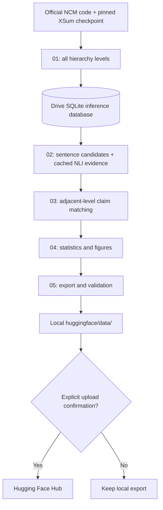

# Execution and Storage Guide

## Architecture

The project deliberately separates compute from analysis:

## Runtime and run identity

The configuration is `github/configs/experiment.yaml`. It identifies the full official XSum test split, NCM repository commit, checkpoint repository revision, decoding settings, NLI model, lifecycle matching threshold, and export paths. A deterministic configuration fingerprint determines the run directory. Changing scientific parameters creates a different run directory instead of mixing records from incompatible settings.

The NCM model is initialized lazily only if unfinished examples remain. Generation outputs for an article are written in one SQLite transaction. When an article has all configured hierarchy levels in the database, subsequent runs skip it. At the end of a successful inference stage, the database is exported to `hierarchy_outputs.jsonl` for transparent inspection.

The annotation stage has a second SQLite cache with a primary key over each claim/evidence chunk/model combination. If interrupted, already-scored evidence pairs are reused. It does not call the NCM generator.

## Scientific boundary

NCM's hierarchy is a cumulative coarse-to-fine sequence of discrete code levels. Each level is decoded into a text reconstruction from the accumulated codes; an intermediate decoded reconstruction is **not assumed to be a shorter extractive summary**. This package analyzes observable factual-claim appearances, disappearances and support-label changes between decoded levels.

Candidate claims are sentence-level units produced by deterministic sentence segmentation. An NLI classifier compares each candidate with a small number of retrieved source-text windows. Labels are thresholded probabilities (`supported`, `contradicted`, `unresolved`), not human ground truth. `unresolved` means the automated method did not find decisive entailment or contradiction; it does not prove a statement is false or absent.

## Data provenance and publishing

NCM's released `passages.pickle` and `reference_summaries.pickle` are downloaded from the official `hazyresearch/ncm-datasets` dataset repository. For factuality evaluation, their references are aligned against the public `EdinburghNLP/xsum` test split using normalized reference text. The pipeline fails closed if alignment coverage is below the configured threshold rather than silently using the wrong article. Source articles and references needed for evaluation are retained privately under the Drive run directory; the public export contains IDs/hashes, decoded NCM outputs, claims, automated labels, transitions and metrics, not full source articles.

Generated NCM summaries may still be subject to upstream dataset/model terms. Review those terms and the rights of all included artifacts before remote publication. The MIT license in `github/` covers our original software; it does not override third-party terms. Hugging Face upload requires an explicit flag and a separate license-review confirmation.

## Resource policy

The default dataset is the complete 11,334-row NCM XSum test set. Batch size defaults to 4 on a single GPU to reduce out-of-memory risk. No runtime estimate is advertised because actual throughput depends on the assigned accelerator, Colab state, model code/dependencies and storage throughput. Resume checkpoints mean interruptions do not force previously completed articles to be generated again. Run a GPU environment/preflight check before starting the full experiment; that check does not load model weights or perform generation.
